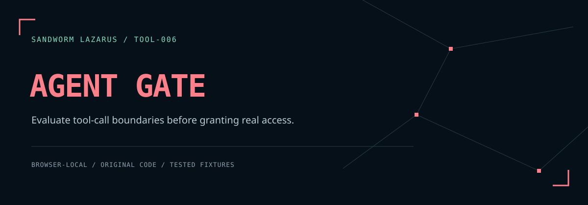

# Sandworm Agent Gate



**An offline policy test harness for AI tool calls.** Inspect why a hypothetical call is allowed, requires review, or is denied before wiring a policy into a real agent system.

[ภาษาไทย](README.th.md) · [Threat model](docs/THREAT_MODEL.md) · [Development](docs/DEVELOPMENT.md)

The browser app and Node library share one deterministic engine. It does **not** execute tools, authenticate users, grant permissions, or enforce a server boundary. An `allow` verdict is a simulation result, not authorization to perform an action.

## What works

- Default-deny tool/action allowlists, exact paths, and segment-boundary path prefixes.
- Explicit deny rules take precedence over allow rules; no glob or regular-expression policies.
- Integer cost budgets in **micro-US dollars** (`costMicrousd`); 1 USD = 1,000,000 μUSD. The smaller global/tool ceiling applies per call.
- Every write returns `review`, even if its tool sets `requireApproval: false`. Reads can require review too.
- Strict bounded JSON input; decoded duplicate keys and prototype-related keys are rejected. Duplicate call IDs deny every occurrence.
- A timeline with reasons, policy/input SHA-256 fingerprints, and aggregate audit export that omits raw IDs, tool names, resource paths, and arguments.
- Input edits, file imports, and resets invalidate old results. Stale asynchronous results cannot re-enable export.
- Sandworm dark/coral design, locally embedded Thai/Latin fonts, no runtime dependencies, telemetry, or persistence.

## Run locally

Node.js 20+ runs tests and the CLI. Python 3 can serve the browser application:

```sh
npm test
npm run check
npm run serve
```

Open `http://127.0.0.1:8080`, choose **ลองตัวอย่าง 6 กรณี**, then **ตรวจนโยบาย**. No dependency installation is required. If npm is unavailable, serve `dist/` with `python3 -m http.server 8080 --bind 127.0.0.1 --directory dist`.

The six synthetic examples produce **1 allow, 1 review, and 4 deny**. They are fabricated fixtures, not evidence of protecting a live agent.

```sh
node scripts/audit.cjs examples/policy.json examples/calls.json
```

The CLI writes audit JSON to stdout; input/read/parse errors return exit code 2 with a generic error. Denied calls are valid audit outcomes, so the CLI still exits 0 when a report is produced.

## Input contract

[examples/policy.json](examples/policy.json) and [examples/calls.json](examples/calls.json) are complete copyable inputs.

Policy keys are exactly `version`, `maxCostMicrousd`, `tools`, `denyTools`, `denyResources`. Each tool has `name`, `actions`, `resources`, `maxCostMicrousd`, and `requireApproval`. A resource rule is `{ "type": "exact" | "prefix", "value": "/absolute/path" }`. Prefix `/workspace/docs` matches itself and children; it does not match `/workspace/docs2`.

Each call has `id`, `tool`, `action`, `resource`, `costMicrousd`, and optional `args` object. Unknown call keys fail closed. `args` is deliberately **not evaluated**. A valid resource path accepts ASCII letters, digits, `-`, `_`, `.`, and `/`; it rejects percent signs, backslashes, URLs, query/fragment text, repeated or trailing separators, and `.` / `..` segments. This restrictive lexical policy does not resolve symlinks or inspect a filesystem.

Limits: 256 KiB of UTF-8 text per input, 200 calls, 30 tools, 50 resource rules per tool, 32 JSON nesting levels, 64-character IDs/tool names, 256-character resource paths, and safe integer costs from 0 to 1,000,000,000,000 μUSD. Costs are supplied estimates, not provider billing information. This version has no cumulative session budget.

## Use the engine

```js
const gate = require('./dist/engine.js');
const result = await gate.audit(policyJsonText, callsJsonText);
console.log(result.counts);
```

`audit()` accepts JSON text and returns a promise. Invalid policy or JSON throws `GateError` with a stable `code` and a generic message. Invalid calls within a valid array become deny rows. Returned audit rows expose sequence number, decision, reason code, numeric tool slot, canonical-call SHA-256, and resource SHA-256.

Policy/input hashes cover exact UTF-8 input bytes; call hashes use recursively sorted object keys. Hashes can reveal equality and permit guessing low-entropy inputs. They are **not encryption, signatures, or anonymization**. Review even a sanitized report before sharing it.

## Validation and boundaries

`npm test` covers behavior and controller invalidation. `npm run check` additionally records source and fixture fingerprints in [reports/validation.json](reports/validation.json). Local results do not claim hosted GitHub Actions success or broad browser compatibility. The browser uses WebCrypto for SHA-256; serve from localhost or HTTPS. Direct `file://` support depends on the browser and is not a verified launch mode.

For production, enforce authorization on the server, validate every tool's argument schema, check object ownership, resolve filesystem boundaries safely, bind approvals to authenticated users and immutable call content, and validate cost estimates at execution time. This lab provides none of those integrations.

## License

Original application code: [MIT](LICENSE), Sandworm-Lazarus. Fonts retain their SIL Open Font License notices; see [THIRD_PARTY_NOTICES.md](THIRD_PARTY_NOTICES.md). The theme follows the user's [Sandworm Lazarus website](https://sandworm-lazarus.pages.dev/) with original local artwork and no imported site scripts.

## Sandworm tools

[Skill Doctor](https://github.com/Sandworm-Lazarus/sandworm-skill-doctor) · [Thai Eval Studio](https://github.com/Sandworm-Lazarus/sandworm-thai-eval) · [GameGuard Lab](https://github.com/Sandworm-Lazarus/sandworm-gameguard-lab) · [AI Run Ledger](https://github.com/Sandworm-Lazarus/sandworm-ai-run-ledger) · [Privacy Workbench](https://github.com/Sandworm-Lazarus/sandworm-privacy-workbench)
