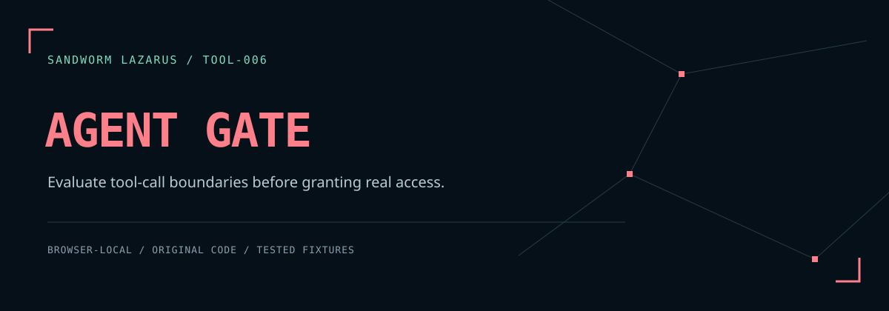

# Sandworm Agent Gate



เครื่องมือทดลองนโยบาย **tool call ของ AI Agent** แบบออฟไลน์ แสดงผล `allow`, `review`, `deny` พร้อมเหตุผลและ audit ที่นำไปตรวจซ้ำได้

[English](README.md) · [ขอบเขตความปลอดภัย](docs/THREAT_MODEL.md) · [บันทึกพัฒนา](docs/DEVELOPMENT.md)

แอปนี้ **ไม่เรียกเครื่องมือ ไม่ให้สิทธิ์จริง และไม่ใช่ตัวบังคับสิทธิ์ฝั่ง server** ผล allow หมายถึงผ่านกฎในการจำลองเท่านั้น

## วิธีใช้

ต้องใช้ Node.js 20+ สำหรับ tests/CLI และ Python 3 สำหรับเปิดเว็บในเครื่อง ไม่ต้องติดตั้ง dependency

```sh
npm test
npm run check
npm run serve
```

เปิด `http://127.0.0.1:8080` → กด **ลองตัวอย่าง 6 กรณี** → **ตรวจนโยบาย** → อ่านเหตุผล → ดาวน์โหลด audit JSON ได้

ตัวอย่างสมมติจะได้ **allow 1, review 1, deny 4** ไม่มีข้อมูลจากระบบหรือผู้ใช้งานจริง

```sh
node scripts/audit.cjs examples/policy.json examples/calls.json
```

CLI แสดงรายงานทาง stdout; หากข้อมูลผิดหรืออ่านไฟล์ไม่ได้จะจบด้วย exit code 2 และข้อความทั่วไป ผล deny เป็นผลตรวจปกติ จึงยังจบด้วย 0 เมื่อสร้างรายงานสำเร็จ

## ทำอะไรได้

- ค่าเริ่มต้นปฏิเสธ ตรวจ tool/action จาก allowlist และทรัพยากรแบบ exact/prefix
- prefix ต้องตรงขอบเขต path เช่น `/workspace/docs` ไม่ครอบคลุม `/workspace/docs2`
- deny rule มีผลเหนือ allow; ไม่รองรับ glob หรือ regex
- งบต่อ call ใช้จำนวนเต็มหน่วย μUSD: 1 USD = 1,000,000 μUSD และใช้เพดานที่ต่ำกว่าระหว่าง global/tool
- ทุก write call ต้องได้ `review` เสมอ ไม่มีปุ่มอนุมัติจริงหรือยืนยันผู้อนุมัติ
- ปฏิเสธ key JSON ซ้ำ, prototype-related keys, ID คำสั่งซ้ำ, path ที่ไม่ canonical และโครงสร้างที่ไม่รองรับ
- ส่งออก audit โดยไม่ใส่ ID, ชื่อ tool, path และ args ต้นฉบับ ใช้ลำดับ/tool slot และ hash แทน
- เมื่อแก้ข้อมูลหรือกฎ ผลเดิมและสิทธิ์ส่งออกจะถูกล้าง รวมถึงกรณีอ่านไฟล์/คำนวณค้างอยู่
- ธีม Sandworm พื้นดำอมฟ้า/แดงคอรัล ฟอนต์เก็บในโปรเจกต์ ไม่มี telemetry หรือการบันทึกลง storage

## รูปแบบข้อมูลและข้อจำกัด

ใช้ [policy ตัวอย่าง](examples/policy.json) และ [calls ตัวอย่าง](examples/calls.json) เป็นจุดเริ่มต้น `args` ต้องเป็น object และ **ไม่ถูกประเมินโดย engine** ผู้พัฒนาต้องตรวจ schema ของ arguments เองในระบบจริง

รองรับ absolute path แบบ ASCII เท่านั้น ไม่รับ `%`, backslash, URL, query/fragment, slash ซ้ำหรือท้าย path และ segment `.` / `..` ไม่อ่าน filesystem หรือแก้ symlink

ขีดจำกัดต่อ input: UTF-8 256 KiB, สูงสุด 200 calls, 30 tools, 50 resource rules ต่อ tool, JSON ลึก 32 ชั้น, ID/tool 64 ตัวอักษร, path 256 ตัวอักษร, ค่าใช้จ่ายจำนวนเต็ม 0–1,000,000,000,000 μUSD งบเป็นค่าที่ผู้ใช้ป้อน ไม่ใช่ราคาจริงจากผู้ให้บริการ และไม่มีงบสะสมต่อ session

SHA-256 ของ policy/input มาจาก bytes ต้นฉบับ ส่วน call hash เรียงชื่อ key ก่อนคำนวณ Hash ใช้ตรวจว่าข้อมูลเปลี่ยนหรือไม่ **ไม่ใช่การเข้ารหัส การลงนาม หรือการทำให้ไม่ระบุตัวตน** ข้อมูลที่เดาง่ายยังสามารถนำมาเทียบ hash ได้

`npm run check` บันทึกผล tests และลายนิ้วมือ source/fixtures ใน [reports/validation.json](reports/validation.json) เป็นผลตรวจในสภาพแวดล้อมที่รัน ไม่อ้างว่า GitHub Actions หรือทุกเบราว์เซอร์ผ่าน ใช้ localhost หรือ HTTPS เพื่อให้ WebCrypto ทำงาน ไม่รับรองการเปิด `file://`

ก่อนใช้แนวคิดกับระบบจริง ต้องเพิ่มการตรวจสิทธิ์ฝั่ง server, เจ้าของข้อมูล, schema ของ tool, การผูก approval กับผู้อนุมัติและเนื้อหาคำสั่ง และตรวจต้นทุนตอนรัน

## สิทธิ์ใช้งาน

โค้ดต้นฉบับ Sandworm-Lazarus ใช้ [MIT](LICENSE) ฟอนต์ใช้ SIL OFL ตาม [THIRD_PARTY_NOTICES.md](THIRD_PARTY_NOTICES.md)

## Sandworm tools

[Skill Doctor](https://github.com/Sandworm-Lazarus/sandworm-skill-doctor) · [Thai Eval Studio](https://github.com/Sandworm-Lazarus/sandworm-thai-eval) · [GameGuard Lab](https://github.com/Sandworm-Lazarus/sandworm-gameguard-lab) · [AI Run Ledger](https://github.com/Sandworm-Lazarus/sandworm-ai-run-ledger) · [Privacy Workbench](https://github.com/Sandworm-Lazarus/sandworm-privacy-workbench)
